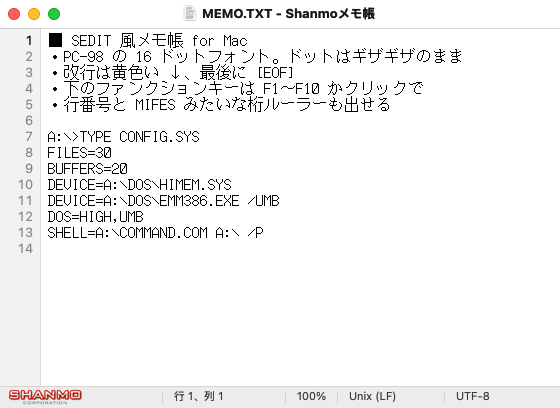
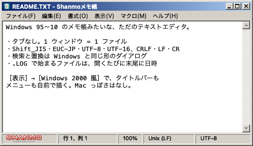

# Shanmoメモ帳（SEDITメモ）for Mac

Windows 95〜10 のメモ帳みたいな、ただのテキストエディタ。
［表示］→［SEDIT 風］で、PC-98（PC-9801）の MS-DOS 5 に付いてた SEDIT みたいな画面にもなる。

![SEDIT 風。黒地に PC-98 の 16 ドットフォント、改行に黄色い ↓、最後に [EOF]、行番号と桁ルーラー、下に F1〜F10 の欄](docs/sedit.png)

Mac に来てから、しっくりくるエディタがなかった。98 のフォントで、SEDIT の見た目で書きたかっただけ。

- 黒地に白、16 ドットの 98 フォント。ズーム 100% ならアンチエイリアスなしで、ドットはギザギザのまま
- 改行に黄色い ↓、最後に [EOF]。いちばん上に状態の行、下に F1〜F10 の欄
- 半角:全角がきっちり 1:2。行番号と、MIFES みたいな桁ルーラーも出せる
- Shift_JIS（CP932）・EUC-JP・UTF-8・UTF-16、CRLF・LF・CR。昔のテキストも、そのままの文字コードで保存
- キーボードマクロ、テーマ（半透明・背景画像も）
- Intel Mac と Apple シリコン。macOS 10.15 以降（Apple シリコンは 11 以降）

SEDIT 風にせんでも、Mac の窓のまま 98 フォントで書ける。Windows 2000 風の窓にもできる。





メモ帳なので、よけいなことはせん:

- **タブなし**: 1 ウィンドウ = 1 ファイル。システム設定で「タブで開く: 常に」にしてても、タブにはならない
- **自動復元なし**: 終了するとき、保存してないものは「保存しますか?」と聞いて終わり。次に起動したら真っさらな「無題」が開く
  （ただし、落ちた・強制終了した・電源が切れたときだけは、保存してなかった中身を次に起動したとき戻す。下の「落ちたとき」）
- **自動保存もなし**: 保存するまでファイルは変わらない（Mac の「バージョン」機能も使わない）

PC-9800 フォント（[retro-type.com](https://retro-type.com/PC98/font/) の `pc-9800.ttf`）は配布条件が書かれてないので、このリポジトリには入れてない。
`./build.sh` のときに落としてきて、自分でビルドしたアプリの中にだけ埋め込む（下の「等幅フォント」）。
なので、使うなら自分の Mac でビルドする。Xcode のコマンドラインツールだけでいい（下の「ビルドとインストール」）。

見た目をまねてるだけで、NEC・Microsoft・SEDIT や MIFES の作り手とは関係ない。

## ビルドとインストール

Xcode 本体は要らない。コマンドラインツールだけでいい。

```sh
xcode-select --install      # 入れてなければ。入ってたら「already installed」と出る
git clone https://github.com/kashinya/shanmomemo.git
cd shanmomemo
./build.sh install          # ビルドして /Applications/Shanmoメモ帳.app に入れる
```

2 回目からは `git pull && ./build.sh install`。

`./build.sh` だけなら `build/Shanmoメモ帳.app` ができるだけ（好きな場所に置けばいい）。
`install` は、前の名前（メモ帳.app など）で入れてた同じアプリ（同じ ID）を消してから入れる（2 つあると .txt の関連付けが迷うので）。

バージョンはビルドするたびに 0.01 ずつ上がる（Ver 1.01、1.02、… 1.99、2.00）。数えた回数はリポジトリの `.build-number`（git には入れない）。
［Shanmoメモ帳について］と、Finder の「情報を見る」に出る。
関数名などの記号はビルドのとき落として、実行ファイルを 3 割ほど小さくしてる（動きは同じ）。残したいときは `NO_STRIP=1 ./build.sh`。
速さより大きさを優先した最適化にするなら `SWIFT_OPT=-Osize ./build.sh`（ふつうは -O）。

SHANMO なしにするときは `NO_SHANMO_LOGO=1 ./build.sh install`。

| | ふつう | `NO_SHANMO_LOGO=1` |
|---|---|---|
| 名前 | Shanmoメモ帳 | SEDITメモ |
| アイコン | 紙に SHANMO CORPORATION のロゴ | 元の紙だけ |
| ステータスバーの左はじ | SHANMO のロゴ | なし |
| 説明（アプリについて・情報を見る） | Copyright (c) 2026 Shanmo Corp | SEDITモード搭載なつかしテキストエディタ |
| ID（設定の置き場所） | `local.memocho` | `local.memocho.sedit` |

ID がちがうので、2 つ並べて入れられる（設定は別々）。両方いっぺんに作るなら `./build.sh both`、両方入れるなら `./build.sh install both`（バージョンは同じになる）。
Dock や Finder が前のアイコンを覚えてて、すぐ変わらんことがある。
Intel Mac と Apple シリコンの両方で動くユニバーサル版になる。macOS 10.15 以降（Apple シリコンは 11 以降）。

自分の Mac でビルドしたアプリなので、Gatekeeper の「開発元を確認できません」は出ない。

### .txt をダブルクリックでこれが開くようにする

Finder で .txt ファイルを選んで ⌘I →「このアプリケーションで開く」で「Shanmoメモ帳」（SEDITメモ）を選んで「すべてを変更…」。
.php や .csv も同じ要領でいける。どのファイルでも「このアプリケーションで開く」の候補には出る。

## Windows のメモ帳との対応

| Windows | このアプリ | メモ |
|---|---|---|
| Ctrl+N 新規 | ⌘N | **新しいウィンドウを開く**（Windows と違って、今のウィンドウの中身は入れ替えない） |
| Ctrl+Shift+N 新しいウィンドウ | ⌘N | ⇧⌘N でも同じ |
| Ctrl+O 開く | ⌘O | **今のウィンドウで開く**（Windows と同じ）。Finder から開いたときは別ウィンドウ |
| Ctrl+S / Ctrl+Shift+S | ⌘S / ⇧⌘S | 保存ダイアログで文字コードと改行コードを選べる |
| — | ファイル > iCloud Drive に保存… / iCloud Drive から開く… | ダイアログを iCloud Drive の場所で開く（iPad などの「ファイル」アプリからも見える）。システム設定で iCloud Drive を使ってるとき |
| — | ファイル > 最近使ったファイル | 開いた・保存したファイルを新しい順に 10 個。選ぶと今のウィンドウで開く（［開く…］と同じ）。いちばん下の［メニューを消去］で空にする |
| Ctrl+P 印刷 | ⌘P | ページ設定は ⇧⌘P |
| Ctrl+F 検索 | ⌘F | Windows と同じ形の検索ダイアログ（方向・大文字小文字・折り返し） |
| F3 / Shift+F3 | ⌘G / ⇧⌘G | fn+F3 も効く |
| Ctrl+H 置換 | ⌥⌘F | ⌘H は Mac では「隠す」なので |
| Ctrl+G 行へ移動 | ⌘L | ⌘G は Mac では「次を検索」なので |
| F5 日付と時刻 | F5 | Mac のキーボードなら fn+F5。「15:37 2026/10/21」形式 |
| Ctrl+プラス/マイナス/0 ズーム | ⌘+ / ⌘- / ⌘0 | トラックパッドのピンチでも |
| 書式 > 右端で折り返す | 同じ | |
| 書式 > フォント | ⌘T | |
| — | 書式 > 等幅フォント | PC-9800 のフォントに切り替える（下の「等幅フォント」） |
| — | 書式 > 行間 | 標準・1.1 倍・1.15 倍・1.2 倍・1.3 倍・1.5 倍・2 倍。広げた分は行の上と下に半分ずつ。印刷も同じ行間 |
| — | 表示 > 文字数 | ステータスバー（SEDIT 風なら上の行）に文字数。改行は数えない。選んでるときは「選んだ数 / 全体」 |
| — | 表示 > 行番号 / 桁ルーラー | 本文の左に行番号、上に MIFES みたいな桁ルーラー（下の「行番号と桁ルーラー」） |
| — | マクロ | キーボードマクロ（下の「キーボードマクロ」） |
| — | 編集 > ファイルを挿入… | 選んだファイルの中身をカーソルの位置に入れる（文字コードは自動判定か指定） |
| 表示 > ステータス バー | 同じ | 行・列、ズーム、改行コード、文字コードを表示。左はじに SHANMO のロゴ（本文 500pt 幅でも入る。それより狭いと隠れる。`NO_SHANMO_LOGO=1` でビルドすると出ない） |
| 設定 > アプリのテーマ | 表示 > テーマ | システム設定に合わせる / ライト / ダーク / Panic Light / Panic Dark / Panic Palette / Neon（下の「テーマ」） |
| ファイルをウィンドウにドロップ | 同じ | 今のウィンドウで開く |

`.LOG` で始まるファイルを開くと末尾に日時が足される、Windows の隠し機能も入れてある。

## 文字コード

開くときは自動判定。順番は BOM → BOM なし UTF-16 → UTF-8 → Shift_JIS / EUC-JP。

- Shift_JIS は Windows と同じ CP932（①、㈱、～ なども Windows どおり）
- 判定を外したときは［ファイル］→［文字コードを指定して開き直す］か、開くダイアログ下の「文字コード」で指定
- 保存は元の文字コード・改行コードのまま。変えたいときは［書式］→［保存時の文字コード］［保存時の改行コード］か、名前を付けて保存のダイアログで
- 新規ファイルは UTF-8 / LF
- Shift_JIS で表せない文字（絵文字など）が入ってたら、保存の前に聞いてくる
- 上書き保存は中身だけ差し替えるので、ファイルの権限（シェルスクリプトの実行権限とか）やシンボリックリンクはそのまま

## 等幅フォント

［書式］→［等幅フォント（PC-9800）］で、PC-98 の 16 ドットのフォントになる。半角:全角がきっちり 1:2。
もう一回選ぶと、フォントパネル（⌘T）で選んだフォントに戻る。フォントパネルでフォントを選んでも、等幅フォントは切れる。

PC-9800 フォントのときは、ズーム 100%・200%・300% ならアンチエイリアスを切って、ドットのギザギザをそのまま出す（フォントパネルで PC-9800 を選んだときも同じ）。
それ以外のズームは、ドットの太さが揃わずガタガタになるので、アンチエイリアスをかける（少しにじむ）。

ただし、ディスプレイ設定の解像度を「スケーリング」にしている Mac（最近の MacBook Air の初期設定など）は、macOS が画面全体を最後に拡大縮小するので、どうしても少しにじむ。

フォントは [retro-type.com](https://retro-type.com/PC98/font/) の `pc-9800.ttf`。
配布条件がどこにも書かれてないので、**このリポジトリには入れてない**。`./build.sh` のときに落としてきて（`Resources/Fonts/` に置いとく）、アプリの中に埋め込む。
Mac 全体にはインストールされない。このアプリの中だけで使える。

- 落とすとき、SHA-256 を確かめる。中身が前と違ったら使わない
- 落とせなかったときや `NO_PC98_FONT=1 ./build.sh` のときは、メニューが［等幅フォント］になって、Osaka−等幅（Mac に入ってるときだけ。入ってなくても落としには行かない）か Menlo を使う
- 自分の好きなフォント（.ttf / .otf）も `Resources/Fonts/` に置けば埋め込まれて、フォントパネルで選べる

## テーマ

［表示］→［テーマ］で本文の色を選ぶ。

- システム設定に合わせる / ライト / ダーク: macOS の色そのまま
- Panic Light / Panic Dark / Panic Palette / Neon: Panic の Prompt のテーマから。設定画面の色見本から逆算した近似値なので、本物とは少し違うことがある。細い縦棒のカーソルで見えにくい色は文字色に寄せた

［表示］→［テーマ］→［テーマの設定…］で:

- 背景の不透明度（20%〜100%）: 100% 未満にすると、本文の後ろにデスクトップが透ける
- 背景の画像: 「選ぶ…」か、枠にドラッグ・貼り付け。本文の後ろにうっすら出る（縦横比はそのままで敷き詰め。スクロールしても画像は動かない）。画像は `~/Library/Application Support/local.memocho/BackgroundImage` に写しを置く
- 画像の濃さ（0%〜80%、初期値 15%）

テーマ・不透明度・画像は Windows 2000 風のときも本文に効く（まわりの灰色の部品は Windows 2000 のまま）。

## 行番号と桁ルーラー

［表示］→［行番号］で本文の左に行番号、［表示］→［桁ルーラー］で本文の上に MIFES みたいな桁のものさし。それぞれオン／オフできる。

- 行番号は改行で区切った行ごと。折り返した続きには番号を付けない。カーソルのある行は目立つ色
- 行番号と桁ルーラーは、本文を半透明にしても透けない（スクロールした字が下に見えないように）
- 桁ルーラーは半角 1 文字を 1 桁として、カーソルのある桁に印を付ける。等幅フォント（初期のフォントや PC-9800）で桁がきっちり合う。等幅でないフォントだとずれる
- 見た目はモードごとに変わる
  - Mac: 本文の地に薄い帯、灰色の数字と目盛り。カーソルの桁はアクセントカラー
  - Windows 2000: ボタン色の帯に黒い字、`....+....1....+....2`。カーソルの行と桁は紺
  - SEDIT: 黒地に水色の字、`....+....1....+....2`（PC-9800 フォント）。カーソルの行と桁は黄色

## キーボードマクロ

［マクロ］メニュー（Windows 2000 風ならウィンドウの中の［マクロ(M)］）。

- ［記録を始める］（⌥⌘R）→ 操作 →［記録を終える］（⌥⌘R）。記録中はタイトルに「[マクロ記録中]」（SEDIT 風は上の行に赤い〈記録中〉）
- ［実行］（⌥⌘P）で 1 回、［回数を指定して実行…］（⌥⇧⌘P）で 1〜99999 回くり返す。途中で検索が見つからなくなったら、そこで止まる。実行した分は「元に戻す」1 回でまとめて戻る
- 覚えるもの: 打った文字（日本語は確定した文字。再生で変換し直しにならない）、カーソル移動・削除・改行などのキー操作、メニューのショートカット（⌘V、⌘G、F3、F5 など）、SEDIT 風のファンクションキー
- 覚えないもの: マウスの操作、メニューをマウスで選んだもの、検索や置換のダイアログの中で打った文字（⌘G などで「次を検索」は覚える）
- メニューのショートカットは、再生のときキーを打ち直すのではなく、そのメニュー項目を直接動かす（メニューバーは光らん。そのとき使えない項目、たとえば選択がないときの［コピー］は飛ばす）
- マウスでの選択やクリックは覚えないので、コピペを入れるときは選択もキーで（⇧＋矢印、⇧⌘→ など）
- ［マクロを保存…］［マクロを開く…］で、ファイル（`.memomacro`、中身は JSON）に保存・読み込み

## SEDIT 風

［表示］→［SEDIT 風］で、PC-98 の MS-DOS 5 に付いてた SEDIT（Ver. 1.03）の画面にする。もう一回選ぶと戻る。

- 黒地に白、PC-9800 フォント（ギザギザ）。行番号を出してないときは左に、ファンクションキーの欄の上にも、Mac のときより少し狭いすき間（4pt）をあける。いちばん上の行の下は 2 ドット（桁ルーラーを出してるときはあけない）。行の高さは PC-98 と同じ 16 ドット
- いちばん上の行: ファイルの場所、〈挿入〉、行／全行数、桁、文字コード、改行コード（数字は白地、見出しは水色地）
- 改行に黄色い ↓、最後に水色の [EOF]
- 下にファンクションキーの欄（数字は黄色、名前は緑）。F1〜F10 を押すか、欄をクリック
  - 80 桁（ズーム 100% で 640pt）入るときは SEDIT と同じ並びを真ん中に。もっと広げると 1 桁ずつ広がる。狭いときは短い名前で詰める
  - 1 切取り / 2 複写 / 3 貼付け / 4 ファイル挿入 / 5 コントロール（［ファイル］メニュー）/ 6 検索 / 7 次検索 / 8 置換 / 9 ジャンプ（行へ移動）/ 0 終了（閉じる）
  - Mac のキーボードで F1〜F10 が明るさや音量になってるときは fn を押しながら（システム設定の「F1、F2 などのキーを標準のファンクションキーとして使用」をオンにすると fn なしで効く）
- ステータスバーは出さない（いちばん上の行が代わり）
- ズーム（⌘+ / ⌘-）すると、いちばん上の行とファンクションキーの欄も一緒に大きくなる
- 行番号と桁ルーラーは塗らずに、後ろの背景（テーマの設定の半透明・背景画像）をそのまま見せる。本文の字とカーソルはルーラーの下には描かない
- Windows 2000 風と一緒にも使える（Windows 2000 の窓の中に SEDIT の画面）
- SEDIT と違うところ: カーソルは Mac の縦棒のまま。「空ﾒﾓﾘ」と「[HELP]:説明」の代わりに文字コードと改行コードを出す

## Windows 2000 風

［表示］→［Windows 2000 風］で、ウィンドウを Windows 2000 の見た目にする。もう一回選ぶと Mac の見た目に戻る。

- Mac のタイトルバーと赤・黄・緑のボタンを消して、紺→水色のタイトルバーと「_ □ ×」のボタンにする。角は四角
  - タイトルバーをドラッグで移動、ダブルクリックで最大化、灰色の外枠をドラッグで大きさを変える
- ウィンドウの中に「ファイル(F) 編集(E) 書式(O) 表示(V) ヘルプ(H)」のメニューバー
- スクロールバーは矢印ボタン付き、ステータスバーはへこんだ欄
- ［表示］→［Mac のメニューバーと Dock を隠す］（初期値はオン）: このアプリが前にある間だけ、画面の上の Mac のメニューバーを自動で隠す。macOS の決まりで、Dock も一緒に自動で隠れる（画面の端にマウスを持っていくと出てくる）
- まわりの部品はいつも Windows 2000 の灰色。本文の色は［表示］→［テーマ］に従う

Mac のまま残るもの: メニューを開いたときの一覧、開く・保存・印刷のダイアログ、フォントパネル、検索・置換・行へ移動・保存確認のダイアログ。

## 覚えている設定

フォント、等幅フォント、行間、テーマ（不透明度・背景画像も）、SEDIT 風、Windows 2000 風、折り返し、ステータスバー、文字数・行番号・桁ルーラーのオン／オフ、検索のオプション、ズーム（最後に変えたものを次に開くウィンドウに）、最近使ったファイル（10 個）、ファイルごとのウィンドウの位置と大きさ。マクロはファイルに保存したときだけ残る。

- 新しいウィンドウと「無題」は、移植元のメモ帳と同じく毎回、画面の左から 260pt・上から 352pt に本文 500×500 で開く。⌘N で開く 2 枚目からは、今のウィンドウから少し右下にずらして開く
- 一回開いた・保存したファイルは、そのウィンドウの位置と大きさを覚えて、次にそのファイルを開いたときはそこに開く（動かしたり大きさを変えたら覚え直す。つないでない画面の位置やったら大きさだけ使う。300 ファイルまで、古いのから忘れる）
- ［表示］→［設定をすべて初期値に戻す…］で、ここに書いたものを全部消して入れたときの状態に戻す（ファイルごとの位置と大きさ・背景画像も。開いてる文書と、開いてるウィンドウの位置はそのまま。ズームは 100% に戻る）

## 落ちたとき

保存してない文書の中身は、15 秒ごとに（変わってたら）`~/Library/Application Support/local.memocho/Recovery/` に控えを書いておく。

- ふつうに閉じた・終わったとき（「保存しない」を選んだときも）は、控えを消す
- 落ちた・強制終了した・電源が切れたあと、次に起動したら、控えの中身でウィンドウを開き直す。保存してない状態（タイトルに *）で、元のファイルがあればそこに上書き保存できる
- 最後の控えから落ちるまでの 15 秒ぶんは戻らないことがある

ここから下の `local.memocho` は、SEDITメモなら `local.memocho.sedit` に読みかえる（ファイルの置き場所の名前も同じ）。

隠し設定: タブ幅（初期値は Windows と同じ 8）

```sh
defaults write local.memocho TabWidth -int 4
```

隠し設定: 変換候補の窓の位置を調べる記録（IME とのやりとりを `~/Library/Logs/local.memocho-ime.log` に書く。調べ終わったら消す）

```sh
defaults write local.memocho IMELog -bool YES    # 記録する（アプリを開き直すと効く）
defaults delete local.memocho IMELog             # やめる
```

設定をまっさらに戻す / アンインストール:

```sh
defaults delete local.memocho
defaults delete local.memocho.sedit
rm -rf "/Applications/Shanmoメモ帳.app" "/Applications/SEDITメモ.app"
```

## 中身

- `Sources/` … Swift（AppKit）。Xcode プロジェクトなし、`build.sh` が swiftc を直接呼ぶ
- `Resources/AppIcon.icns` … アイコン（SHANMO のロゴ入り）。`AppIcon-plain.icns` はロゴなし（`NO_SHANMO_LOGO=1` のとき）
- `docs/` … README の画面写真（CI で、PC-9800 フォント込みのビルドを動かして撮る）
- `tools/` … CI 用（起動の速さを測る・画面写真の見本の文）
- `Resources/StatusLogo.png` … ステータスバーのロゴ
- アプリ名を変えたいとき: `APP_NAME=Notepad ./build.sh`
